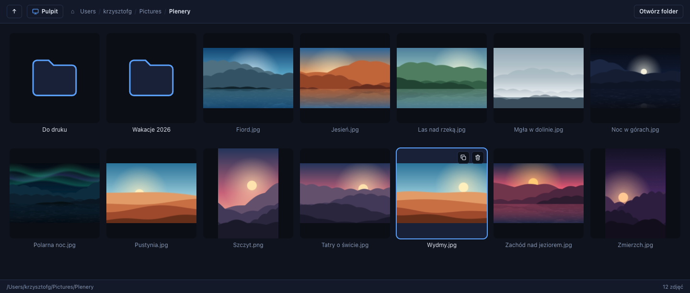

# Painter

**A fast, keyboard-friendly image browser for macOS: folder thumbnails, a zoomable preview, crop, rotate, duplicate, print, and self-updates.**

Electron · React · TypeScript



Finder's grid is slow to scan, and Preview opens one window per photo. I wanted a single quiet window where I can fly through a folder with the arrow keys, fix a crooked or badly framed photo in two clicks, and print it, all without leaving the keyboard. Painter is that tool, and I use it daily.

## Features

- **Folder browsing:** a thumbnail grid with breadcrumbs. The app remembers the last folder and starts in Pictures on first launch.
- **Preview:** zoom in and out in fixed steps and step through the folder with ← →.
- **Crop** in two modes:
  - *Quick:* drag across the image and the crop is saved when you release.
  - *Precise:* adjust each edge, then confirm.
- **Rotate** left or right by a quarter turn.
- **Safe edits:** a crop or rotation replaces the file, but the original goes to the Trash, so any edit can be undone from Finder.
- **Duplicate:** a copy named `-kopia` in the same folder. Duplicate and delete are also available straight from the grid tile.
- **Print:** keep the proportions or stretch to the whole page. Page orientation follows the image.
- **Delete:** moves the file to the Trash and never deletes it permanently.
- **Finder integration:** Painter appears in *Open With* for images, opens files dropped on its Dock icon, and can reveal the current folder in Finder.
- **Self-updating:** on launch, Painter checks GitHub Releases and offers to install a newer version.

Supported formats: JPG, PNG, GIF, WebP, BMP, TIFF, HEIC/HEIF and SVG. Crop and rotate work on JPG, PNG and WebP.


## Keyboard shortcuts

| Shortcut | Action |
| --- | --- |
| ← → ↑ ↓ | Select the neighbouring file or folder |
| Enter | Open the selected file or folder |
| ⇧↓ | Enter the selected folder |
| ⇧↑ (or ⌘↑, ⌥↑) | Go up one folder |
| ⌘⇧D | Desktop |
| ← / → (in preview) | Previous / next image |
| + / − | Zoom in / out |
| ⌘P | Print |
| Enter | Confirm the crop (precise mode) |
| Esc | Cancel crop / close preview |

## Engineering highlights

- **A custom `thumb://` protocol instead of loading full photos.** [`thumbnailProtocol.ts`](src/main/thumbnailProtocol.ts) asks macOS Quick Look (`nativeImage.createThumbnailFromPath`) to decode each image at tile size. That is far cheaper than decoding a 20-megapixel photo and also covers HEIC and SVG. Thumbnails are served with immutable cache headers. The URL includes the file's mtime, so an edited image refreshes on its own. The protocol serves image files only, so the page cannot use it to read arbitrary files from disk.
- **Editing on a canvas, in the file's own format.** Crop and rotate run on a canvas and write back in the original format and name (JPEG and WebP re-encoded at 0.95 quality). The image bytes come over IPC rather than from the preview ``, because that image is cross-origin and would taint the canvas.
- **Edits are recoverable.** The new bytes are written to a hidden temp file first. Only then does the original go to the Trash, and the temp file takes its name ([`folderHandlers.ts`](src/main/folderHandlers.ts)). A failed write never leaves you without a photo.
- **Printing with a real preview.** Electron's print dialog on macOS has no preview, so Painter renders an A4 PDF and opens it in Preview. There you can see the layout, and ⌘P prints as usual.
- **No race conditions while navigating.** Each folder listing carries a request ID. A slow listing that arrives after you've already moved on is discarded, so it can't overwrite the current folder.
- **Race-free "Open With".** macOS can send `open-file` before the window, or even the app, is ready. The main process buffers the path, and the page collects it when it starts.
- **A self-updater without a framework.** [`updater.ts`](src/main/updater.ts) compares semver against the latest GitHub release and extracts the zip with `ditto`, which preserves Electron's framework symlinks. A detached shell process swaps the app bundle only after the app has quit, then relaunches it. The updater detects macOS App Translocation and folders without write access, and falls back to the release page with a clear message.

## Architecture

```
src/
  main/       Electron main process: window, file operations, thumbnail protocol, updater
  preload/    the typed API exposed to the page as window.api
  renderer/   React UI: grid, preview, crop/rotate, keyboard navigation
  shared/     types and constants shared by both sides
scripts/      release script and an Electron install fix
```

**Stack:** Electron 33, React 18, TypeScript (strict), electron-vite, electron-builder. There are no runtime dependencies beyond React.

## Install

1. Download `Painter-<version>-arm64.dmg` (or `Painter-<version>-arm64-mac.zip`) from the [latest release](https://github.com/g-krzysztof/painter/releases/latest).
2. Move `Painter.app` to **Applications**.
3. The app is not signed with an Apple certificate, so remove the download quarantine once:
   ```sh
   xattr -cr /Applications/Painter.app
   ```
   Without this step macOS reports that **"Painter" is damaged and can't be opened**, and right-click → Open doesn't help. The file isn't damaged. The browser marks downloads as quarantined, and macOS then refuses an unsigned app. You only need to do this once per Mac. Updates installed from inside the app aren't quarantined.

Builds target Apple Silicon (arm64) Macs. The interface is in Polish.

## Updates

On every launch Painter checks the latest release in this repository. If a newer version exists, it asks whether to install it. If you agree, Painter:

1. downloads the zip,
2. quits,
3. replaces `Painter.app`,
4. relaunches.

For this to work, the app must live in a folder you can write to, usually **Applications**, not in Downloads or inside the mounted dmg. The repository must also be public. If installation fails, the app offers to open the release page so you can download the new version manually.

## Development

Requires macOS, Node.js and npm.

```sh
npm install        # installs dependencies (a postinstall script fixes Electron's unpacking on Node 26)
npm run dev        # run with hot reload
npm run typecheck  # TypeScript, both main and renderer
npm run dist:mac   # build Painter.app into dist/mac-arm64 (no installer)
```

The app doesn't check for updates in development mode.

### Releasing

One-time setup: install the [GitHub CLI](https://cli.github.com) and run `gh auth login`.

For each release:

1. Bump `version` in `package.json` (e.g. `0.1.3` → `0.2.0`), commit and push.
2. Run:
   ```sh
   npm run release:mac
   ```
   [`scripts/release.sh`](scripts/release.sh) builds the zip and dmg and publishes them as GitHub release `v<version>`.
3. Installed copies offer the update on their next launch.

The repository the app updates from is set in `REPO` in [`src/main/updater.ts`](src/main/updater.ts).

## License

[MIT](LICENSE)
